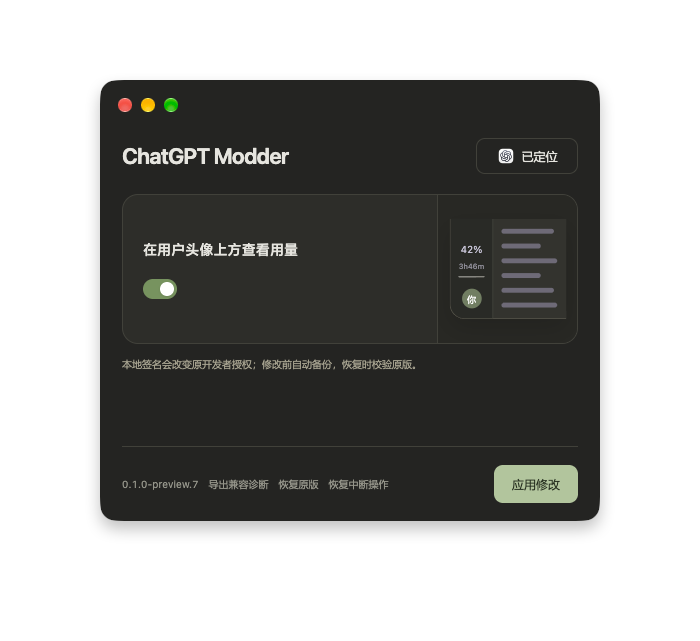
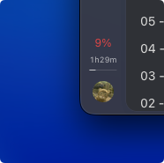

# ChatGPT Modder

可扩展、无需后台常驻的 ChatGPT 桌面修改器。Electron + TypeScript，仅加载内置模块。

当前版本 **0.1.0-preview.12**。macOS 与 Windows 已由用户确认验证可用，两端当前适配 ChatGPT **26.1027.30824**。

## 首个模块

头像上方显示 5H 剩余百分比、重置倒计时及周剩余细进度条。百分比不超过 10% 时变红，单位为小写，进度条为 1px。复用客户端账号额度状态；未知或失效数据使用占位，切换账号清除旧数据。组件自带异步与异常边界，不应阻塞整页初始化。

## 截图



修改器界面示例，由用户提供，截图版本为 macOS preview.7；当前发行版本见下方下载页。



额度模块实机示例：剩余 9% 时红色提醒、小写倒计时和细周进度条。截图不代表所有平台与启动流程均已验收。

## 下载

[下载 0.1.0-preview.12](https://github.com/GarliC-C/chatgpt-modder/releases/tag/v0.1.0-preview.12)：macOS Apple Silicon 提供既定背景与拖拽布局的 DMG，Windows x64 提供便携 EXE，同时附 SHA256 校验文件。仓库及发行已公开，可直接下载。

macOS DMG 沿用拖拽安装布局，窗口为 768×602，底部使用生成的毯面纹理扩展，较上一版再增加 10pt。安装包仅包含修改器。

## 开发

使用 Node.js 24、npm、Git。在干净克隆目录执行：

```sh
npm ci
npm run typecheck
npm test
npm run build
npm start
```

macOS 与 Windows 可分别执行 `npm run pack:mac`、`npm run pack:win`。macOS 还可执行 `npm run pack:dmg`，重绘背景时需要本机 Swift/AppKit；这些命令不适用于 Windows。Windows 打包使用内置 ICO 与 PE 资源编辑脚本，不依赖 Icon Composer 或 Wine。

Windows 调试的首个步骤是只读采集安装元信息：

```powershell
powershell.exe -NoProfile -File .\scripts\diagnose-windows-discovery.ps1
```

若系统策略禁止执行脚本，请按交接文档逐条运行只读命令；无需更改系统执行策略。结果位于 `diagnostics/`，不会自动上传。

## 兼容版本

| 平台 | ChatGPT 版本 | 安装包 |
| --- | --- | --- |
| macOS Apple Silicon | 26.1027.30824 | DMG |
| Windows x64 | 26.1027.30824 | 便携 EXE |

两平台已由用户确认可用。官方更新到已知受支持版本后，重新应用会建立独立备份并保留旧版记录；同版本异常变化仍拒绝修改。旧 26.1023.51421 适配记录保留；新版本仍需匹配对应平台的资源指纹。macOS 和 Windows 同版本的资源哈希不同，分别校验。未提供 macOS Intel 包。

Windows 商店安装使用用户目录副本，请从 **ChatGPT（Modder）** 快捷方式启动。官方安装及原快捷方式保持不变；副本不随商店自动更新。详见 [Windows 使用说明](docs/WINDOWS-OPERATION-AND-RISKS.md)。

## 目录

- `src/engine/`：发现、识别、完整性、备份、事务与恢复。
- `src/modules/`：内置额度模块及已知版本适配器。
- `src/ui/`：简化界面与预览。
- `scripts/`：构建、图标与只读诊断。
- `build/`：原创图标、Icon Composer 源文件和 DMG 背景。
- `docs/`：当前交接、架构、验证及故障记录；`docs/history/` 为历史记录。

[Windows 运作原理与风险](docs/WINDOWS-OPERATION-AND-RISKS.md) · [架构与扩展](docs/ARCHITECTURE.md) · [验证状态](docs/VALIDATION.md) · [Windows 验证清单](docs/WINDOWS-TEST.md)

## 发布与恢复

仅分发修改器及原创补丁，不分发官方客户端或其修改副本。客户端运行时拒绝修改；失败回滚；版本或指纹改变后拒绝套用旧补丁和旧备份。关闭最后窗口即退出，无托盘、启动项或后台服务。

安装包尚未使用公开发行证书签名或 Apple 公证。

MIT 许可证只覆盖本项目原创代码；第三方归属见 [THIRD-PARTY-NOTICES.txt](THIRD-PARTY-NOTICES.txt)。图标人物名称 Tibo、DMG 背景与文字由用户指定；不代表官方发布或背书。
